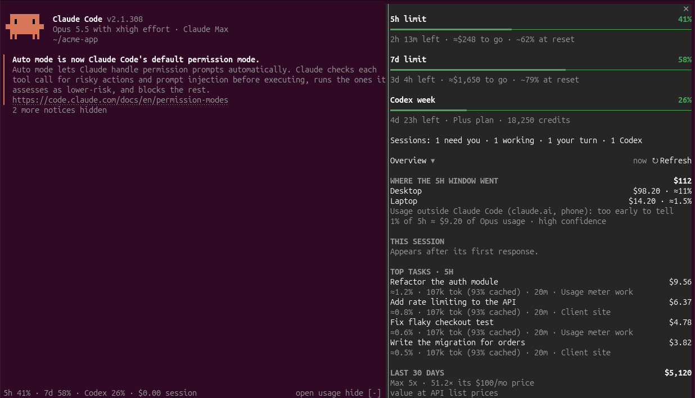

# usage-meter

**See exactly where your Claude usage goes, live, inside Claude Code.**

https://github.com/user-attachments/assets/bcb43cc6-a6dd-48e8-b80d-d9de9b03ba7b

Hit a limit sooner than you expected and wondering whether it got nerfed? usage-meter
shows your 5-hour and weekly plan limits as they move, what's using them (which session,
subagent, prompt and model), how fast you're burning, and how much you have left in
real terms. It works out how much of *your* plan each model's tokens use, from your own data.



- **Limit %, live and explained.** The 5h and 7d limits with time left, budget left
  and where you'll be at reset, plus a status line and a band above the prompt.
- **Learned from your own data.** It fits how fast each model family uses your plan's
  limits, so "≈$248 to go" means real headroom, not a guess. It also notices when usage
  outside Claude Code (claude.ai, the phone app) is eating your limit.
- **Where every token went.** By session, subagent, prompt, model, effort, skill, MCP
  server, project and machine, with cache hits and the cache rebuilds that cost you.
- **API-equivalent $** for every request at list prices (cache writes by TTL, fast mode,
  web search), so you can see what your plan is worth.
- **Cache countdown.** After 10 idle minutes, the band counts down to the prompt cache
  expiring (after that, your next message re-caches the whole conversation).
- **Every machine in one view**, synced over SSH. **Codex too**: its limits, its runs,
  and a Stop button for runs Claude launched.
- **Local only.** Everything is read from files Claude Code already writes on your machine.
  Nothing is uploaded; the only network traffic is the SSH sync you set up yourself.

## Install

In Claude Code (terminal), paste:

```
/plugin install usage-meter --marketplace rohit3a/usage-meter
```

Answer `y` to add the marketplace, press Enter through the scope and settings screens (the
defaults are fine), then type `/burn`.

In the **desktop app**: click **+** next to the prompt box → **Plugins** → **Add marketplace**,
enter `rohit3a/usage-meter`, then add **usage-meter**.

That's all. On the first session start the mod sets up its collector, a small Python process
that reads your transcripts and does the math, as a background service (systemd on Linux,
launchd on macOS, a detached process on Windows), and tells you it did. It reads your existing history right away, so the
numbers aren't empty on day one. When the plugin updates, the collector updates with it.

**Needs:** Claude Code 2.1.280 or later, Python 3.9+ (`python3`; macOS has it with the
Xcode command line tools; on Windows `python` is enough), macOS, Linux (WSL included) or Windows. Some older builds (2.1.280 among them) keep mods behind a
switch: add `"CLAUDE_CODE_ENABLE_FUNCTION_HOOKS": "1"` to the `env` block of `~/.claude/settings.json`.

<details>
<summary>Or install from a shell</summary>

```bash
curl -fsSL https://raw.githubusercontent.com/rohit3a/usage-meter/main/install.sh | bash
```

This clones the repository to `~/.local/share/usage-meter`, loads the mod in every Claude Code
session (`~/.claude/skills/usage-meter`), sets the function-hooks switch and starts the
collector. Re-running it updates. Use one install method, not both.
</details>

## Use

| | |
| --- | --- |
| `/burn` | open the usage pane: limits, budget left, sessions, and breakdowns behind the **Overview** menu |
| `/burn text` | the same summary as plain text |
| `/burn band` | hide or show the band above the prompt |
| `/burn setup` | (re)start the collector, e.g. after `/burn uninstall` |
| `/burn uninstall` | stop and remove the collector (your data stays in `~/.claude/usage-meter`) |

**Settings:** `/plugin configure usage-meter`, or in the desktop app's plugin settings:

| Option | Default | |
| --- | --- | --- |
| Start the collector automatically | on | off: nothing runs until you type `/burn setup` |
| Cache countdown | on | the idle countdown in the band |
| Compact idle sessions | off | see below |
| Idle compaction: minimum context | 150,000 | only sessions at least this big are compacted |
| Prompt cache lifetime (minutes) | 60 | 60 on a subscription; 5 where only the 5-minute cache is used |

### More than one machine

Install on each machine, then name each one and point it at the others by SSH host
(anything `ssh <host>` reaches without a password prompt, e.g. a Tailscale name):

```bash
python3 ~/.claude/usage-meter/app/collector/umeter.py config --host Desktop --peer Laptop=my-laptop   # on the desktop
python3 ~/.claude/usage-meter/app/collector/umeter.py config --host Laptop                             # on the laptop
```

Each machine pushes its own ledger and pulls the others' every 20 seconds. The pane's footer
shows each machine as live, a time since its last sync, or offline.

On Windows, sync needs `rsync` on PATH (Windows doesn't ship it), and the Codex Stop button
is not supported: the collector can't find which process writes a Codex run there.

### Idle cache countdown and compaction

Claude Code caches a session's prompt for an hour after its last request. Once that
lapses, your next message pays to cache the whole conversation again (2× input price
on every token of context). After 10 minutes idle the band shows how long is left:

```
◷ cache expires in 12m · 352k context · auto-compacts in 7m
```

With **Compact idle sessions** on, a session holding at least 150k tokens of context
is compacted 5 minutes before its cache expires, while the cache can still serve the
read, so the next message caches a short summary instead. It's off by default.
It never runs during a turn, while a subagent or Codex run is going, or twice for one idle stretch.

### Headless (`claude -p`) runs

Runs started with `--no-session-persistence` (benchmarks, scripts, CI) write no
transcript, so the collector can't see them, yet they use your plan's limits. If you
keep their `--output-format stream-json` output, list the folders in
`~/.claude/usage-meter/local/collector.json` and run `/burn setup`:

```json
"streamLogs": [
  { "label": "Benchmarks", "cwd": "~/code/bench", "match": "*claude*.jsonl", "dirs": ["~/code/bench/logs"] }
]
```

Each log becomes a session titled `<label> · <file name>` under the `cwd`'s project.
Requests are counted as they stream (output from the thinking estimates), then topped
up to the exact per-model totals of the run's closing `result` event.

## Troubleshooting

`/burn` says what's wrong when the collector can't start. From a shell:

```bash
python3 ~/.claude/usage-meter/app/collector/umeter.py status   # running? up to date?
journalctl --user -u usage-meter -n 50                         # Linux: the collector's log
tail -50 ~/.claude/usage-meter/local/collector.log             # macOS, or no systemd
```

- **"Needs Python 3.9 or later"**: install Python 3 so that `python3` is on your PATH (macOS:
  `xcode-select --install` or Homebrew), then `/burn setup`.
- **Numbers stale / "collector has stopped"**: `/burn setup` restarts it.
- **No systemd (some WSL setups, containers)**: the collector runs as a plain background
  process instead, and the next session start brings it back if it died.

**Uninstall:** `/burn uninstall`, then `/plugin uninstall usage-meter`. Delete
`~/.claude/usage-meter` to remove your usage history too.

## How it works

- **`mod/collector/umeter.py`**: one per machine, always running (systemd user
  service on Linux, launchd agent on macOS, a background process elsewhere). Reads Claude Code's transcripts
  (`~/.claude/projects/**.jsonl`) incrementally into a compact ledger, one file per
  UTC day, at `~/.claude/usage-meter/hosts/<host>/days/`. Each request is keyed by
  its API message id, so nothing is counted twice, and carries its model, effort
  level, skill and MCP server. With peers configured it syncs every 20 s over
  SSH: it pushes its own `hosts/<host>/` and pulls each peer's.
- **`mod/collector/view.py`**: inside the collector, does all the arithmetic in its own
  process and writes `local/view.json` (about 100 KB), plus a detail file per recently
  active session in `local/sessions/`. A rebuild takes a fraction of a second (about
  0.2 s for a week of 40k requests) and runs on demand: when the pane opens, once a
  minute while it's open, and on Refresh. Otherwise it runs once an hour, if the ledger
  or the limit readings changed, so the band's learned rates stay current. The
  transcript scan is incremental: a full walk once a minute, recent files every 10 s.
- **`mod/`**: the Claude Code mod. It reads `view.json` only when it changes (a
  stat every 2 s while the pane is open), records the plan-limit readings only a
  live session sees, and draws the status line, the live band above the prompt and
  the `/burn` pane. It never crunches the ledger itself, so the UI stays responsive.
- **`mod/collector/live.py`**: follows Codex runs (`~/.codex/sessions/**/rollout-*.jsonl`)
  and live Claude sessions (Claude Code's own `~/.claude/sessions/<pid>.json` plus
  each transcript's tail). Each machine writes `hosts/<host>/codex.json` and
  `fleet.json` (synced); the collector merges every machine's into `local/live.json`.
  A Codex run Claude started (`codex exec` in a Bash call, or T3 Code's delegate_task) is
  linked to that chat and prompt. **Stop** drops `local/stop/<run>.json`; the
  collector sends SIGINT (SIGTERM after 8 s) only to a process that is Codex *and*
  holds that run's log open.
- **`mod/collector/service.py`**: setup. The plugin's folder changes with every version,
  so the collector runs from a copy in `~/.claude/usage-meter/app/`. At each session start the
  mod runs `umeter.py install --if-needed`, which checks (in about 0.1 s) that a collector on
  the plugin's current code is running, and copies, restarts or starts it when not.
- **`mod/prices.json`**: list prices for the collector. Cache writes are priced by
  TTL (5m 1.25×, 1h 2× input); fast mode 2× on Opus 5/5.5; web search $0.01.

### Data

```
~/.claude/usage-meter/
  app/                           the collector's code, copied from the plugin
  config.json                    plan name and price (synced)
  local/view.json                everything the pane draws (rebuilt by the collector)
  local/sessions/<id>.json       per-session detail for "This session"
  local/live.json                Codex runs, Codex limits and live sessions, every machine
  local/refresh                  the pane's Refresh button: rebuild now
  hosts/<host>/days/<day>.json   requests; written only by <host>'s collector
  hosts/<host>/limits.json       5h / 7d limit readings
  hosts/<host>/status.json       collector heartbeat and sync results
  local/collector.json           this machine's name, sync peers and stream-log folders
  local/state.json               transcript read offsets (rebuildable)
  local/setup.json               which code and service the collector runs on
```

The desktop app keeps local copies of sessions it runs on another machine over SSH
(`~/.claude/projects/ssh-*` on the client). They're ingested with the session
marked `remote`. A message from a remote copy counts only when no machine
recorded it as its own, so remote sessions aren't double counted and a remote host
without a collector still shows up.

### How the % is attributed

Two meters, kept separate:

- **API-equivalent $**: every request at today's API list prices (`mod/prices.json`,
  with dated changes), so the Sonnet 5.5 cache-read cut shows up here.
- **Limit %**: how fast each model uses *your plan's* limits, learned from data.
  Anthropic reports each window in whole points. Sessions save a reading on every
  change (and every 10 minutes), so the collector knows when each point was first
  seen while someone was watching. Between two such crossings, points =
  Σ over model families (weight × plan-reference $), where plan-reference $
  ignores API-only price changes (`"apiOnly": true`; Claude Code plan limits didn't
  change with the Sonnet cut). The weights are fit by least squares, each pulled
  toward the overall rate with about one point's worth of evidence, so a family with
  no data counts like its price and one with data counts like its data.

In practice Sonnet 5.5 cache reads have measured at about 0.70× Opus per token, and a
week holds about 3.5 full 5h windows. Your own weights are learned from your own readings.

Budget left = (100 − % − 0.5) / Opus weight, shown as Opus-equivalent $. Burn = the
last fifth of the window's usage by model × its weight. "Outside Claude Code" is
only claimed when there are 3+ consistent stretches and the gap is a whole point.

## Development

```bash
git clone https://github.com/rohit3a/usage-meter.git && cd usage-meter
deploy/install.sh                        # loads mod/ from this checkout in every session
(cd mod && claude plugin validate . && claude plugin test .)
python3 mod/collector/umeter.py report --hours 5   # spend per machine and session
```

Edits to `mod/hooks/` reload in open sessions; edits to `mod/collector/` reach the running
collector at the next session start (or `/burn setup`). Bump `VERSION` in `umeter.py` when the
ledger format changes: each machine rebuilds from its transcripts on restart (about 20 s to a minute).

## License

MIT
